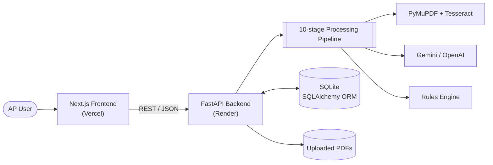
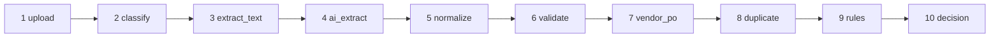
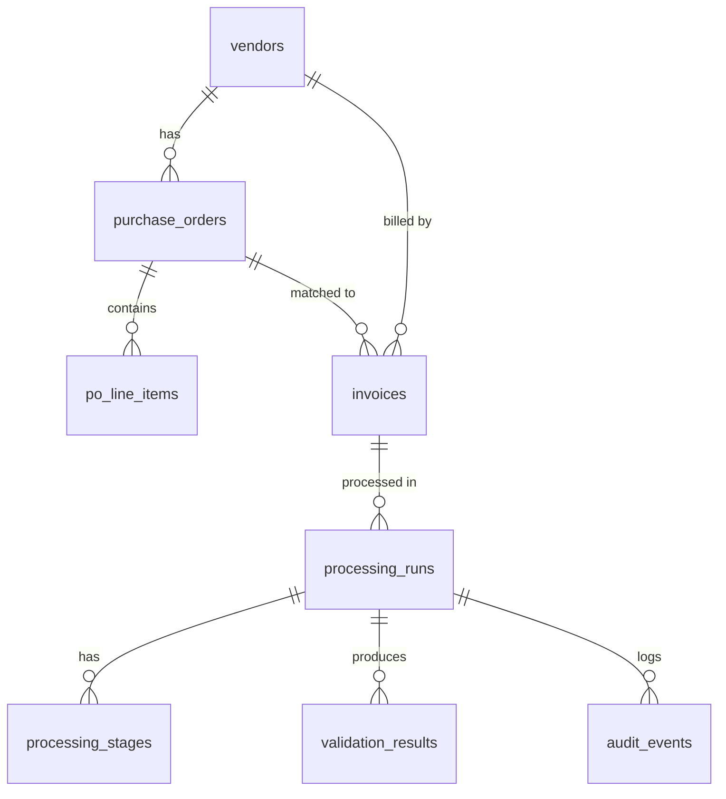

<div align="center">

# 🧾 InvoiceAI — Intelligent Invoice Processing

**AI-powered, end-to-end Accounts Payable automation.**
Upload a vendor invoice PDF and get an explainable approval decision in seconds — with a complete audit trail.

[](https://nextjs.org)
[](https://react.dev)
[](https://www.typescriptlang.org)
[](https://tailwindcss.com)
[](https://fastapi.tiangolo.com)
[](https://www.python.org)
[](https://www.sqlalchemy.org)
[](#-tech-stack)

[**Live Demo**](https://frontendupdated-two.vercel.app) · [**API Docs (Swagger)**](https://invoice-ai-backend-fdsf.onrender.com/docs) · [**Report a Bug**](../../issues)

</div>

---

## 📑 Table of Contents

- [Overview](#-overview)
- [Key Features](#-key-features)
- [Architecture](#-architecture)
- [Processing Pipeline](#-processing-pipeline)
- [Business Rules Engine](#-business-rules-engine)
- [Tech Stack](#-tech-stack)
- [Quick Start](#-quick-start)
- [Configuration](#-configuration)
- [API Reference](#-api-reference)
- [Seed Data](#-seed-data)
- [Database Schema](#-database-schema)
- [Testing](#-testing)
- [Deployment](#-deployment)
- [Project Structure](#-project-structure)
- [Troubleshooting](#-troubleshooting)
- [Roadmap](#-roadmap)

---

## 🔍 Overview

InvoiceAI automates the invoice-review workflow of an Accounts Payable team. It accepts PDF invoices (digital **and** scanned), extracts every field with an LLM, validates them against the vendor master and purchase orders, runs a deterministic rules engine, and produces one of three decisions:

| Decision | Meaning | Typical cause |
|---|---|---|
| ✅ **Approved** | All checks passed — safe to pay | Clean invoice matching vendor and PO |
| ⚠️ **Needs Review** | Soft warnings — an AP user must verify | Low OCR confidence, missing invoice number, amount variance > 2% |
| ❌ **Rejected** | A blocking rule fired | Duplicate, unknown/inactive vendor, PO mismatch, currency mismatch |

AI is used **only for extraction**. Every approval decision comes from deterministic, explainable rules, so results are consistent and auditable.

---

## ✨ Key Features

| | Feature | Description |
|---|---|---|
| 📄 | **PDF classification** | Detects digital vs. scanned PDFs from the embedded-text ratio |
| 🔎 | **OCR** | Tesseract fallback for scanned / image-based invoices |
| 🤖 | **AI field extraction** | Google Gemini (default) or OpenAI returns structured JSON |
| 🧹 | **Normalization** | Cleans dates, amounts and currency codes; flags missing fields |
| 🧮 | **Arithmetic validation** | Checks `subtotal + tax = total` and line-item sums |
| 🏢 | **Vendor verification** | GSTIN / Tax ID first, then fuzzy name and alias matching |
| 📦 | **PO matching** | Verifies PO ownership, status, currency and remaining balance |
| 🔁 | **Duplicate detection** | Two tiers: exact (blocking) and fuzzy (review) |
| 📏 | **11 business rules** | Deterministic evaluation with severity levels |
| 📡 | **Live progress** | Stage-by-stage status in the UI while a run executes |
| 🗂️ | **Audit trail** | Every stage, validation and rule outcome is persisted |
| 📊 | **Dashboard & history** | Live stats, searchable invoice history, original PDF viewer |

---

## 🏗 Architecture



**Frontend routes**

| Route | Purpose |
|---|---|
| `/` | Landing page — product overview and features |
| `/dashboard` | Live stats and recent invoices |
| `/upload` | Upload an invoice PDF |
| `/runs/[id]` | Live pipeline progress for a run |
| `/invoices` | Searchable, filterable invoice history |
| `/invoices/[id]` | Full invoice detail, validations, rule outcomes and original PDF |

---

## ⚙️ Processing Pipeline

Every upload creates a *processing run* that passes through 10 sequential stages:



| # | Stage | What happens |
|---|---|---|
| 1 | `upload` | File validated (PDF, max 20 MB), saved to disk, invoice record created |
| 2 | `classify` | PDF classified as `digital` or `scanned` |
| 3 | `extract_text` | Text via PyMuPDF (digital) or Tesseract OCR (scanned) |
| 4 | `ai_extract` | Raw text sent to Gemini / OpenAI; structured JSON returned |
| 5 | `normalize` | Dates, amounts and currencies cleaned; missing fields identified |
| 6 | `validate` | Arithmetic checks on totals and line items |
| 7 | `vendor_po` | Vendor looked up by GSTIN then fuzzy name; PO matched, balance checked |
| 8 | `duplicate` | Exact and fuzzy duplicate detection |
| 9 | `rules` | All 11 business rules evaluated |
| 10 | `decision` | Final status set with explanation and recommended action |

---

## 📏 Business Rules Engine

| Rule | Severity | Trigger |
|---|---|---|
| **R01** Duplicate invoice | 🔴 Blocking | Same invoice number + vendor already approved / in review |
| **R01** Resubmission | 🟡 Review | Exact match against a previously *rejected* invoice |
| **R01** Possible duplicate | 🟡 Review | Same vendor + amount + date with a fuzzy invoice-number match |
| **R02** Vendor not found | 🔴 Blocking | Vendor name / GSTIN not in the vendor master |
| **R03** Vendor inactive | 🔴 Blocking | Vendor found but status is not `approved` |
| **R04** Missing invoice number | 🟡 Review | Invoice number could not be extracted |
| **R05** Mandatory fields | 🟡 Review | Vendor, total or date is absent |
| **R06** Arithmetic failure | 🟡 Review | Totals or line items don't add up |
| **R07** Low confidence | 🟡 Review | Extraction confidence < 60% (always for scanned PDFs) |
| **R08** No PO match | 🔴 / 🟡 | PO belongs to another vendor (blocking) or PO not found (review) |
| **R09** PO not approved | 🔴 Blocking | Matched PO is `inactive` or `closed` |
| **R10** Currency mismatch | 🔴 Blocking | Invoice currency differs from PO currency |
| **R11** Amount tolerance | 🟡 Review | Invoice differs from PO by more than the tolerance (default 2%) |

**Decision logic**

```text
any BLOCKING rule triggered                 →  rejected
REVIEW rules triggered, none BLOCKING       →  needs_review
no rules triggered                          →  approved
```

---

## 🧰 Tech Stack

<table>
<tr><th>Layer</th><th>Technologies</th></tr>
<tr><td><b>Frontend</b></td><td>Next.js 15 (App Router) · React 19 · TypeScript · Tailwind CSS · Lucide Icons · Axios</td></tr>
<tr><td><b>Backend</b></td><td>FastAPI · Uvicorn · SQLAlchemy 2.0 · Pydantic v2 · pydantic-settings</td></tr>
<tr><td><b>Document AI</b></td><td>PyMuPDF · Tesseract (pytesseract) · Google Gemini (<code>gemini-2.5-flash</code>) · OpenAI (<code>gpt-4o-mini</code>)</td></tr>
<tr><td><b>Matching</b></td><td>thefuzz (fuzzy string matching) · python-dateutil</td></tr>
<tr><td><b>Data</b></td><td>SQLite (file-based)</td></tr>
<tr><td><b>Hosting</b></td><td>Vercel (frontend) · Render (backend)</td></tr>
</table>

---

## 🚀 Quick Start

### Prerequisites

- **Python 3.10+** (3.11 recommended)
- **Node.js 18+** and npm
- **Tesseract OCR** — only needed for scanned PDFs
  - Windows: [UB Mannheim installer](https://github.com/UB-Mannheim/tesseract/wiki) → `C:\Program Files\Tesseract-OCR\`
  - macOS: `brew install tesseract`
  - Ubuntu / Debian: `sudo apt install tesseract-ocr`
- A **Google Gemini** API key (default) **or** an **OpenAI** API key

### 1. Clone

```bash
git clone <your-repo-url>
cd Invoice_system
```

### 2. Backend

```bash
cd backend
python -m venv venv
source venv/bin/activate          # Windows: venv\Scripts\activate
pip install -r requirements.txt

cp .env.example .env              # then add your API key (see Configuration)
python seed_data.py               # load vendors and purchase orders

uvicorn app.main:app --reload --port 8000
```

### 3. Frontend

```bash
cd frontend_updated
npm install
echo "NEXT_PUBLIC_API_URL=http://localhost:8000" > .env.local
npm run dev
```

### 4. Open

| Service | URL |
|---|---|
| Web app | http://localhost:3000 |
| API | http://localhost:8000 |
| Swagger UI | http://localhost:8000/docs |
| ReDoc | http://localhost:8000/redoc |

---

## 🔧 Configuration

### Backend — `backend/.env`

| Variable | Default | Description |
|---|---|---|
| `AI_PROVIDER` | `gemini` | `gemini` or `openai` |
| `GEMINI_API_KEY` | — | Required when `AI_PROVIDER=gemini` |
| `OPENAI_API_KEY` | — | Required when `AI_PROVIDER=openai` |
| `DATABASE_URL` | `sqlite:///./invoice_system.db` | SQLAlchemy connection string |
| `UPLOAD_DIR` | `uploads` | Where uploaded PDFs are stored |
| `TOLERANCE_THRESHOLD` | `0.02` | Allowed invoice-vs-PO variance (2%) |
| `ALLOWED_ORIGINS` | `http://localhost:3000,http://127.0.0.1:3000` | Comma-separated CORS origins |

### Frontend — `frontend_updated/.env.local`

| Variable | Example | Description |
|---|---|---|
| `NEXT_PUBLIC_API_URL` | `http://localhost:8000` | Base URL of the backend API |

---

## 📡 API Reference

Interactive docs are served at `/docs` (Swagger) and `/redoc`.

| Method | Endpoint | Description |
|---|---|---|
| `GET` | `/api/health` | Health check |
| `GET` | `/api/dashboard/` | Aggregate stats and recent invoices |
| `POST` | `/api/invoices/upload` | Upload a PDF (`multipart/form-data`, max 20 MB); starts a run |
| `GET` | `/api/invoices/` | List invoices, newest first |
| `GET` | `/api/invoices/{invoice_id}` | Invoice detail with extracted fields and status |
| `GET` | `/api/invoices/{invoice_id}/runs` | All processing runs for an invoice |
| `GET` | `/api/invoices/runs/{run_id}` | Run detail: stages, validations, audit events |
| `GET` | `/api/invoices/runs/{run_id}/stream` | Server-Sent Events stream of run progress |
| `GET` | `/api/vendors/` · `/api/vendors/{vendor_id}` | Vendor master |
| `GET` | `/api/purchase-orders/` · `/api/purchase-orders/{po_number}` | Purchase orders |
| `GET` | `/uploads/{stored_filename}` | Original uploaded PDF |

<details>
<summary><b>Example — upload an invoice with curl</b></summary>

```bash
curl -X POST http://localhost:8000/api/invoices/upload \
  -F "file=@backend/test_invoices/invoice_happy_path.pdf"
```

The response is the processing-run summary. Poll `GET /api/invoices/runs/{run_id}` (or open the SSE stream) until `status` is no longer `running`.

</details>

---

## 🌱 Seed Data

`seed_data.py` loads **6 vendors** and **7 purchase orders** for demos and tests.

<details>
<summary><b>Vendors</b></summary>

| ID | Legal name | Currency | Tax ID | Status |
|---|---|---|---|---|
| V001 | ABC Technologies Pvt Ltd | INR | TEST-TAX-001 | approved |
| V002 | XYZ Solutions Pvt Ltd | INR | TEST-TAX-002 | approved |
| V003 | Global Services Inc | INR | TEST-TAX-003 | inactive |
| V004 | Northstar Systems Ltd | INR | TEST-TAX-004 | approved |
| V005 | Pinnacle Consulting Group | INR | TEST-TAX-005 | approved |
| V006 | Northwind Office Supplies Pvt. Ltd. | USD | 05AABCN1234F1Z5 | approved |

</details>

<details>
<summary><b>Purchase orders</b></summary>

| PO number | Vendor | Amount | Currency | Status |
|---|---|---|---|---|
| PO-10045 | V001 ABC Technologies | 53,100.00 | INR | approved |
| PO-10048 | V001 ABC Technologies | 1,20,000.00 | INR | approved |
| PO-10046 | V002 XYZ Solutions | 25,000.00 | INR | approved |
| PO-10047 | V003 Global Services | 75,000.00 | INR | inactive |
| PO-10049 | V004 Northstar Systems | 26,500.00 | INR | approved |
| PO-10050 | V005 Pinnacle Consulting | 1,80,000.00 | INR | approved |
| PO-2026-1093 | V006 Northwind Office Supplies | 4,900.00 | USD | approved |

</details>

Reset to a clean demo state (clears invoices, runs and audit data; restores PO balances; keeps vendors and POs):

```bash
cd backend && python reset_demo.py
```

---

## 🗄 Database Schema



| Table | Description |
|---|---|
| `vendors` | Vendor master — legal name, aliases, tax ID, status, currency |
| `purchase_orders` | PO header — vendor, amounts, currency, status, running balance |
| `po_line_items` | PO line items — description, quantity, unit price, amount |
| `invoices` | Uploaded invoices — extracted fields, matched vendor / PO, final status |
| `processing_runs` | One run per upload — status, current stage, timestamps |
| `processing_stages` | One row per stage per run — status and output summary |
| `validation_results` | Arithmetic checks and rule outcomes per run |
| `audit_events` | Structured event log per run |

---

## 🧪 Testing

Run from `backend/` with the virtual environment active and the API key configured:

```bash
python test_e2e.py            # end-to-end pipeline
python test_pipeline.py       # happy-path invoice
python test_duplicate.py      # duplicate detection
python test_all_scenarios.py  # edge-case invoices
python test_phase4.py         # additional feature checks
```

Sample invoices live in `backend/test_invoices/`:

| File | Expected outcome |
|---|---|
| `invoice_happy_path.pdf` | ✅ Approved |
| `invoice_duplicate.pdf` / `ec01_duplicate.pdf` | ❌ Rejected (R01) |
| `invoice_inactive_vendor.pdf` | ❌ Rejected (R03) |
| `invoice_po_mismatch.pdf` / `ec03_po_mismatch.pdf` | ❌ Rejected (R08) |
| `invoice_missing_number.pdf` / `ec02_missing_number.pdf` | ⚠️ Needs Review (R04) |
| `ec04_poor_scan.pdf` | ⚠️ Needs Review (R07) |

---

## ☁️ Deployment

### Backend → Render

1. Create a **Web Service** from this repository. `render.yaml` at the repo root defines the service.
2. Set environment variables in the Render dashboard:

   | Variable | Value |
   |---|---|
   | `AI_PROVIDER` | `gemini` |
   | `GEMINI_API_KEY` | your key (set as a secret) |
   | `ALLOWED_ORIGINS` | your Vercel URL, e.g. `https://your-app.vercel.app` |
   | `UPLOAD_DIR` | `uploads` |
   | `TOLERANCE_THRESHOLD` | `0.02` |

3. `backend/start.py` is the production entrypoint: it creates tables, **auto-seeds** vendors and POs if the database is empty, then starts Uvicorn on Render's `$PORT`.

Scanned-PDF support requires the **Tesseract** binary at runtime. The `render.yaml` build command installs it automatically (`apt-get install -y tesseract-ocr`). For other platforms, install Tesseract manually (see [Prerequisites](#prerequisites)).

For production use, switch `DATABASE_URL` to PostgreSQL and store uploaded PDFs in object storage (S3 / GCS).

### Frontend → Vercel

1. Import the repository and set **Root Directory** to `frontend_updated`.
2. Add `NEXT_PUBLIC_API_URL` pointing at your Render backend URL.
3. Deploy — Vercel auto-detects Next.js.

---

## 📁 Project Structure

```text
Invoice_system/
├── render.yaml                      # Render service definition
├── backend/
│   ├── app/
│   │   ├── main.py                  # FastAPI app, CORS, router registration
│   │   ├── config.py                # Env-driven settings (pydantic-settings)
│   │   ├── database.py              # SQLAlchemy engine and session
│   │   ├── models/models.py         # ORM models
│   │   ├── schemas/schemas.py       # Pydantic request/response schemas
│   │   ├── routers/                 # invoices · vendors · purchase_orders · dashboard
│   │   └── services/
│   │       ├── pipeline.py          # 10-stage orchestrator
│   │       ├── pdf_extractor.py     # PyMuPDF + Tesseract OCR
│   │       ├── ai_extractor.py      # Gemini / OpenAI extraction
│   │       ├── normalizer.py        # Cleaning and arithmetic validation
│   │       ├── vendor_verifier.py   # GSTIN + fuzzy vendor lookup
│   │       ├── po_matcher.py        # PO matching and balance tracking
│   │       ├── duplicate_detector.py# Two-tier duplicate detection
│   │       ├── rules_engine.py      # 11 business rules
│   │       ├── decision_engine.py   # Final status from rule results
│   │       └── run_manager.py       # Run / stage lifecycle helpers
│   ├── start.py                     # Production entrypoint (tables → seed → uvicorn)
│   ├── seed_data.py · reset_demo.py # Demo data helpers
│   ├── test_*.py · test_invoices/   # Tests and sample PDFs
│   └── requirements.txt
└── frontend_updated/
    ├── app/                         # Next.js App Router pages
    │   ├── page.tsx                 # Landing page
    │   ├── dashboard/ upload/ invoices/ runs/
    │   └── layout.tsx               # Root layout (Navbar + Footer)
    ├── components/                  # Navbar · Footer · StatusBadge
    └── lib/                         # api.ts (Axios client) · types.ts
```

---

## 🩺 Troubleshooting

| Symptom | Likely cause and fix |
|---|---|
| UI shows *"Could not connect to backend"* | Backend isn't running, or `NEXT_PUBLIC_API_URL` is wrong. Restart the frontend after editing `.env.local`. |
| Browser CORS error | Add your frontend origin to `ALLOWED_ORIGINS` on the backend. |
| Scanned PDFs fail or return low confidence | Tesseract isn't installed or isn't on the path. On Windows the code expects `C:\Program Files\Tesseract-OCR\tesseract.exe`. |
| Extraction fails | Check `AI_PROVIDER` and that the matching API key is set and valid. |
| `npm install` reports peer-dependency conflicts | Run `npm install --legacy-peer-deps`. |
| Demo gets cluttered | Run `python reset_demo.py`. |

---

## 🗺 Roadmap

- [ ] PostgreSQL support and migrations (Alembic is already a dependency)
- [ ] Object storage for uploaded PDFs
- [ ] Authentication and role-based access (AP clerk / approver)
- [ ] Manual approve / reject actions on *Needs Review* invoices
- [ ] Multi-currency conversion for PO tolerance checks
- [ ] CI pipeline running the test suite on every pull request

---

<div align="center">

Built with FastAPI, Next.js and Gemini.

</div>
